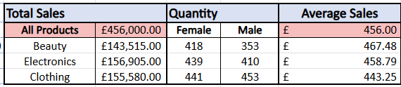
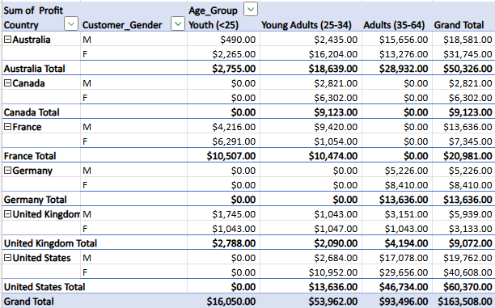
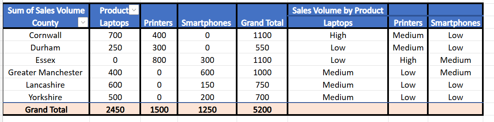

# Excel: sales data analysis

Short business questions on sales, HR and other training data, answered in Excel with formulas, pivot tables, lookups and charts.

## At a glance

| | |
|---|---|
| **Tools** | Microsoft Excel: sort and filter, SUM, AVERAGE, SUMIF, COUNTIF, pivot tables and pivot charts, SWITCH, XLOOKUP, VLOOKUP with a named range, COUNT and COUNTA, conditional formatting, line, column and pie charts |
| **Datasets** | Retail sales (1,000 transactions), two bike sales lab files, a 12-row county sales table, a student scores sheet, 21 Atlantic hurricanes, an HR file of 14 employees |
| **Bootcamp week** | Week 1 (September 2026), Level 3 Data Technician Skills Bootcamp, Leep Talent |
| **Type** | Individual exercises on training datasets |
| **Files** | My Excel workbooks and the bootcamp workbook with my written answers, listed at the bottom of this page |

## Objective

- **Retail:** what sold, in total and on average, by category and by gender?
- **Bike sales:** which countries sell to which customer segments, and which is most profitable in each?
- **County sales:** how do sales split by county and product, and which count as high, medium or low volume?
- **Charts:** which chart best shows revenue, profit and revenue by age group?
- **HR:** what does each employee take home, and how do headcount and salary split by department and gender?

I also practised lookups and researched the UK laws on customer data (summarised below).

## Data

| Dataset | What it contains | Fields I used |
|---|---|---|
| Retail sales | 1,000 transactions, almost all dated 2023, across Beauty, Clothing and Electronics | Transaction ID, Gender, Age, Product Category, Quantity, Price per Unit, total sale |
| Bike sales (pivot lab) | Orders by country, age group and gender | Country, Age_Group, Customer_Gender, Order_Quantity, Profit |
| Bike sales (charts lab) | Revenue and profit by year, country, product and age group | Year, country, product category, age group, revenue and profit |
| County sales | 12 rows: six English counties, three products | County, Product, Sales Volume |
| Student scores | English and Mathematics marks for a small class [CONFIRM: dataset name and number of subjects] | Subject scores, average, highest score |
| Atlantic hurricanes | 21 major hurricanes from 1870 to 2017, with a Saffir-Simpson category table | Name, Category, Max Wind Speed |
| HR payroll and headcount | 14 fictional employees with salary, gender and department, plus hours worked over one week | Name, Gender, Salary, Department, daily hours |

The retail data is the synthetic "Retail Sales Dataset" from Kaggle (mohammadtalib786) [ADD: link to the Kaggle page], so it holds no real customers' data. It states no currency, so values are described as sales, not pounds. [CONFIRM: corrected, see fixes list]

## Approach

1. **Retail sales.** Sorted customers by age, then summarised total sales, quantity by gender and average sale for each category.
2. **Student scores.** Sorted each subject, added a colour-scaled average column, then sorted by average and highest score.
3. **Bike sales pivots.** Pivot tables and a pivot chart of order quantity and profit by country, age group and gender.
4. **County sales.** A pivot table of sales volume by county and product, then `SWITCH(TRUE, ...)` to label each sale High (over 600), Medium (300 to 600) or Low (under 300).
5. **Charts.** A line chart of revenue and profit, a stacked column chart of product revenue by country, and a pie chart of revenue by age group.
6. **Lookups.** XLOOKUP for each retail transaction's customer gender, with COUNT and COUNTA on the result, and VLOOKUP for each hurricane category's wind speed.
7. **HR payroll.** VLOOKUP on a named range turns each salary into an hourly rate (÷ 40 hours ÷ 52 weeks). Hours × rate gives gross pay, less the exercise's flat tax (32%), social security (8%) and pension (5%). SUMIF and COUNTIF summarise salary and headcount by department and gender.

```
=XLOOKUP(A2, retail_sales_dataset!A:A, retail_sales_dataset!D:D, "Not found")
=SWITCH(TRUE, C2 > 600, "High", C2 >= 300, "Medium", "Low")
```

Column D holds Gender in the master file. [CONFIRM: corrected, see fixes list]

## Skills used

**Technical**
- Pivot tables built to answer specific questions
- Nested conditions with `SWITCH(TRUE, ...)`
- XLOOKUP and VLOOKUP (including on a named range), and COUNT versus COUNTA
- SUMIF and COUNTIF summaries with absolute references, and ROUND so payslips add up to the penny [CONFIRM: corrected, see fixes list]
- Conditional formatting and chart choice

**Transferable**
- Accuracy: summaries reconcile (retail to 456,000, salaries to £391,056), and my VLOOKUP matches the original column for all 21 storms
- Reading a brief closely: the file has no commission column, so the "commission" figures are labelled as sales [CONFIRM: corrected, see fixes list]
- Explaining a choice: why a bar chart beats a pie chart here

## Results and findings

**Retail sales by category**

| Category | Total sales | Quantity (female) | Quantity (male) | Average sale |
|---|---:|---:|---:|---:|
| Beauty | 143,515 | 418 | 353 | 467.48 |
| Clothing | 155,580 | 441 | 453 | 443.25 |
| Electronics | 156,905 | 439 | 410 | 458.79 |
| **All products** | **456,000** | | | **456.00** |

Electronics brought in the most revenue, but Beauty had the highest average sale.



**Bike sales pivot questions**
- Germany's orders all came from Adults (35 to 64), with an order quantity of 13.
- Australia and the United Kingdom both have orders in every age group and gender. [CONFIRM: corrected, see fixes list]
- Most profitable by segment: France for Youth ($10,507), Australia for Young Adults ($18,639), and the United States for Adults, women and men. The US made $60,370 of the $163,508 total.



**County sales.** Of the 12 sales, two were High (Cornwall laptops, 700, and Essex printers, 800), seven Medium and three Low.



[ADD: screenshot of the SWITCH column on the source data, saved as images/county-sales-switch-column.png]

**Chart choice.** The pie gives Adults 50% of revenue, Young Adults 36%, Youth 14% and Seniors under 1%. A bar chart compares them more easily: lengths are easier to judge than angles, and the Seniors slice is unreadable. [CONFIRM: corrected, see fixes list]

**HR payroll and headcount.** Sales is the largest department (6 people, £179,898 of the £391,056 salary bill), then Purchasing (5, £137,557) and Logistics (3, £73,601). Nine of the 14 employees are men, so total salary by gender mostly reflects headcount and average salary is the fairer comparison. [ADD: average salary by gender, once you've added AVERAGEIF] Flat deductions mean everyone takes home 55% of gross pay.

[ADD: screenshot of the payroll sheet, saved as images/hr-payroll.png]

## Handling data responsibly

| Law | What it means for working with data |
|---|---|
| UK GDPR | Seven principles (lawfulness, fairness and transparency; purpose limitation; data minimisation; accuracy; storage limitation; integrity and confidentiality; accountability). Since 5 February 2026 there are seven lawful bases for processing, after the Data (Use and Access) Act 2025 added "recognised legitimate interests". It also applies to organisations outside the UK that offer goods or services to, or monitor, people in the UK. In practice: pull only the customer fields an analysis needs. [CONFIRM: corrected, see fixes list] |
| Data Protection Act 2018 | Sets out the UK's detail, exemptions and fines (up to £17.5 million or 4% of global annual turnover, whichever is higher) and makes some misuse of personal data a criminal offence. Example: leave out customers who opted out of marketing, and delete the list when the campaign ends. |
| Freedom of Information Act 2000 | Gives anyone a right to request recorded information from public bodies, which must respond within 20 working days. Notes and spreadsheet comments can be disclosable. Deliberately destroying requested records is an offence: in 2020 a town council clerk who deleted a recording was fined £400 and ordered to pay £1,493 costs. |
| Computer Misuse Act 1990 | The UK's main anti-hacking law, covering insiders as well as outside attackers. Example: request access formally rather than borrowing a colleague's login. Breaches can lead to prosecution and prison. |

## Challenges and what I learned

- **Boundaries matter.** "Greater than 600" means a sale of exactly 600 is Medium, so the order of conditions in `SWITCH(TRUE, ...)` decides the answer.
- **COUNT counts numbers only.** COUNT returned 0 for text columns while COUNTA returned 9.
- **Check the whole table.** I first said only the UK sells to every segment; Australia does too. [CONFIRM: corrected, see fixes list]
- **Lock ranges before copying.** My gender COUNTIF shifted from B4:B17 to B5:B17 when copied down; the count was right only because row 4 is a man. [CONFIRM: corrected, see fixes list]
- **Round money at each step.** Six of 14 payslips were a penny out as displayed, because unrounded values were carried through. [CONFIRM: corrected, see fixes list]

## Where this applies

Testing items against a threshold, checking that totals agree by segment and recalculating payroll deductions are everyday audit and tax work. For an analyst, picking the chart that answers the question makes a report usable by non-specialists.

## Repository contents

| File | What it contains |
|---|---|
| Data Technician Week 1 (Word document) | The Leep Talent Week 1 workbook with my written answers |
| `retail-sales-analysis` | Day 2: sorting, SUM and AVERAGE, plus XLOOKUP practice |
| `bike-sales-pivot-lab` | Day 3 Task 1: pivot tables |
| `county-sales-switch` | Day 3 Task 2: pivot table and SWITCH |
| `bike-sales-charts-lab` | Day 3 Task 3: charts |
| `hurricane-vlookup-practice` | Day 3: VLOOKUP |
| `hr-payroll-and-headcount` | HR payroll, SUMIF and COUNTIF [CONFIRM: which day] |
| [`images/`](images/) | Screenshots used in this README |

Each workbook contains the data and my work for that task.
