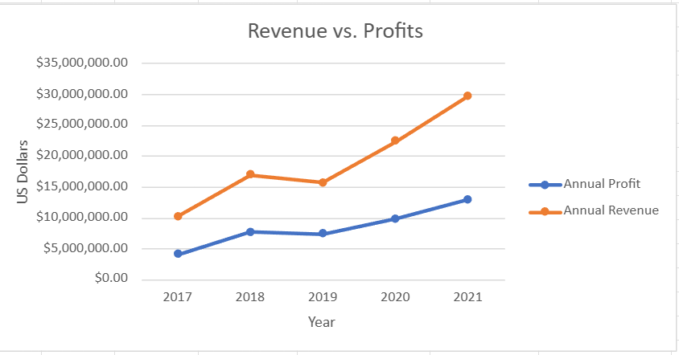
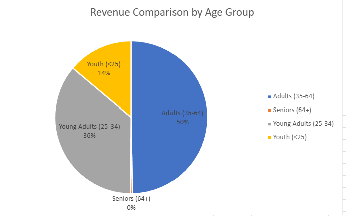

# 📊 Excel: sales data analysis

**Formulas, pivot tables, lookups and charts used to answer short business questions on sales and HR data.**

Six Excel workbooks from Week 1 of my bootcamp. I summarised retail sales, built pivot tables on bike and county sales, chose charts for a bike sales lab, practised lookups and calculated payroll for a small HR file. I also researched the UK laws on handling customer data.

## 🔎 At a glance

| | |
|---|---|
| **Tools** | Microsoft Excel |
| **Datasets** | Retail sales (1,000 transactions), two bike sales lab files, a 12-row county sales table, a student scores sheet, 21 Atlantic hurricanes, an HR file of 14 employees |
| **Bootcamp week** | Week 1 (September 2026), Level 3 Data Technician Skills Bootcamp, Leep Talent |
| **Type** | Individual exercises on training datasets |
| **Files** | My Excel workbooks and the bootcamp workbook with my written answers, listed at the bottom of this page |

## 💡 Skills demonstrated

**✔️ Formulas and lookups**
- SUM, AVERAGE, SUMIF and COUNTIF to summarise sales, salaries and headcount (retail sales, HR payroll)
- Nested conditions with `SWITCH(TRUE, ...)` to label each sale High, Medium or Low (county sales)
- XLOOKUP, and VLOOKUP including on a named range (retail sales, hurricanes, HR payroll)
- COUNT versus COUNTA on lookup results (retail sales)

**✔️ Pivot tables**
- Pivot tables and a pivot chart of order quantity and profit by country, age group and gender (bike sales)
- A pivot table of sales volume by county and product (county sales)

**✔️ Sorting and formatting**
- Sorting by age, subject, average and highest score (retail sales, student scores)
- Conditional formatting with a colour-scaled average column (student scores)

**✔️ Charts**
- A line chart for change over time, a stacked column chart for totals and their make-up, and a pie chart, with my case for why a bar chart would be clearer (bike sales charts lab)

**✔️ Checking the numbers**
- Summaries that reconcile: retail to 456,000 and salaries to £391,056
- A VLOOKUP that matches the original column for all 21 storms
- Checking data against the brief: the task asked for commission, but the file has no commission column, so the figures are total sales

## 📗 Exercises covered

| Task | What I did |
|---|---|
| Retail sales | Sorted customers by age, then summarised total sales, quantity by gender and average sale for each category |
| Student scores | Sorted each subject, added a colour-scaled average column, then sorted by average and highest score |
| Bike sales pivots | Pivot tables and a pivot chart of order quantity and profit by country, age group and gender |
| County sales | A pivot table of sales volume by county and product, then `SWITCH(TRUE, ...)` to label each sale High (over 600), Medium (300 to 600) or Low (under 300) |
| Charts | A line chart of revenue and profit, a stacked column chart of product revenue by country, and a pie chart of revenue by age group |
| Lookups | XLOOKUP to return each retail customer's gender, and VLOOKUP to return each hurricane category's wind speed |
| HR payroll | VLOOKUP on a named range turns each salary into an hourly rate (÷ 40 hours ÷ 52 weeks). Hours × rate gives gross pay, less the exercise's flat tax (32%), social security (8%) and pension (5%) |

```
=SWITCH(TRUE, C2 > 600, "High", C2 >= 300, "Medium", "Low")
```

The retail data is the synthetic "Retail Sales Dataset" from Kaggle (mohammadtalib786), so it holds no real customers' data. It states no currency, so values are described as sales, not pounds.

## 📈 Results

**Retail sales by category**

| Category | Total sales | Quantity (female) | Quantity (male) | Average sale |
|---|---:|---:|---:|---:|
| Beauty | 143,515 | 418 | 353 | 467.48 |
| Clothing | 155,580 | 441 | 453 | 443.25 |
| Electronics | 156,905 | 439 | 410 | 458.79 |
| **All products** | **456,000** | | | **456.00** |

Electronics brought in the most revenue, but Beauty had the highest average sale.

**Bike sales pivots.** Germany's orders all came from Adults (35 to 64). Australia and the United Kingdom have orders in every age group and gender. The most profitable country was France for Youth ($10,507), Australia for Young Adults ($18,639) and the United States for Adults, women and men. The US made $60,370 of the $163,508 total.


**County sales.** Of the 12 sales, two were High (Cornwall laptops, 700, and Essex printers, 800), seven Medium and three Low.


**Charts.** Annual revenue roughly tripled between 2017 and 2021, with a dip in 2019, and profit followed the same path at a lower level. The United States and Australia bring in the most revenue, and bikes make up most of every country's total.



The pie gives Adults 50% of revenue, Young Adults 36%, Youth 14% and Seniors under 1%. A bar chart compares them more easily: lengths are easier to judge than angles, and the Seniors slice is unreadable.



**HR payroll.** Sales is the largest department (6 people, £179,898 of the £391,056 salary bill), then Purchasing (5, £137,557) and Logistics (3, £73,601). Average salary is £28,176 for men and £27,494 for women. Flat deductions mean everyone takes home 55% of gross pay.

## 🔒 Handling data responsibly

| Law | What it means for working with data |
|---|---|
| UK GDPR | Seven principles, including data minimisation and storage limitation. Since 5 February 2026 there are seven lawful bases for processing, after the Data (Use and Access) Act 2025 added "recognised legitimate interests". In practice: pull only the customer fields an analysis needs. |
| Data Protection Act 2018 | Sets out the UK's exemptions and fines (up to £17.5 million or 4% of global annual turnover, whichever is higher). Example: leave out customers who opted out of marketing, and delete the list when the campaign ends. |
| Freedom of Information Act 2000 | Anyone can request recorded information from public bodies, which must respond within 20 working days. Deliberately destroying requested records is an offence. |
| Computer Misuse Act 1990 | The UK's main anti-hacking law, covering insiders as well as outside attackers. Example: request access formally rather than borrowing a colleague's login. |

## 🎓 Key learning outcomes

- **Boundaries matter.** "Greater than 600" means a sale of exactly 600 is Medium, so the order of conditions in `SWITCH(TRUE, ...)` decides the answer.
- **COUNT counts numbers only.** It returned 0 for text columns, while COUNTA returned 9.
- **Check the whole table.** I first said only the UK sells to every segment, but Australia does too.
- **Compare averages when groups differ in size.** Nine of the 14 employees are men, so average salary is a fairer comparison than total salary.

## 🧠 What I'd change

- **Lock ranges before copying.** In the gender headcount, the COUNTIF range shifted from B4:B17 to B5:B17 when copied down. The count is only right because row 4 is a man. `$B$4:$B$17` fixes it.
- **Round money at each step.** Six of the 14 payslips are a penny out when the displayed figures are added up, because unrounded values carry through. Wrapping each step in `ROUND(..., 2)` fixes it.

## 🛠️ Tools and technologies

- **Microsoft Excel:** formulas, lookups, pivot tables and pivot charts, conditional formatting and charts

## 📁 Repository contents

| File | What it contains |
|---|---|
| Data Technician Week 1 (Word document) | The Leep Talent Week 1 workbook with my written answers |
| `retail-sales-analysis` | Day 2: sorting, SUM and AVERAGE, plus XLOOKUP practice |
| `bike-sales-pivot-lab` | Day 3 Task 1: pivot tables |
| `county-sales-switch` | Day 3 Task 2: pivot table and SWITCH |
| `bike-sales-charts-lab` | Day 3 Task 3: charts |
| `hurricane-vlookup-practice` | Day 3: VLOOKUP |
| `hr-payroll-and-headcount` | HR payroll, SUMIF and COUNTIF |
| [`images/`](images/) | Screenshots used in this README |

Each workbook contains the data and my work for that task.
